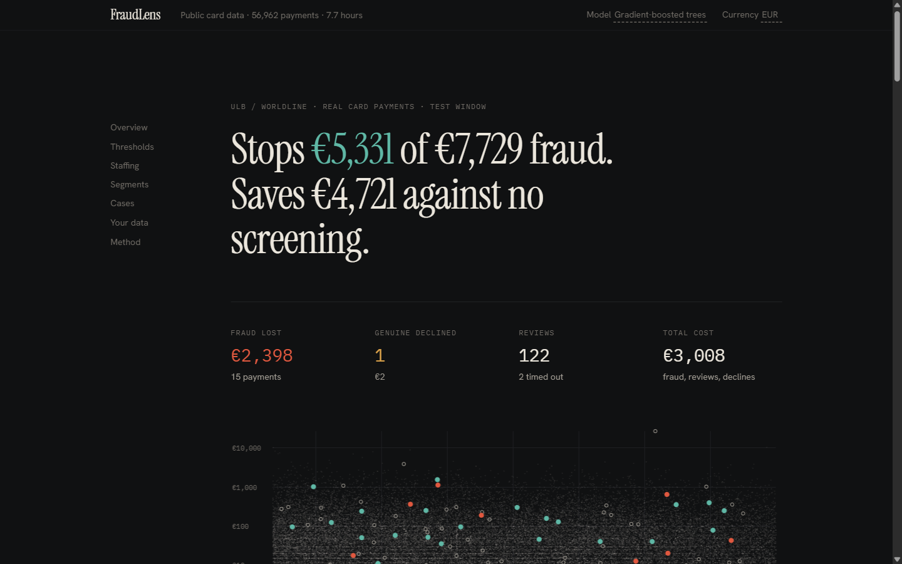
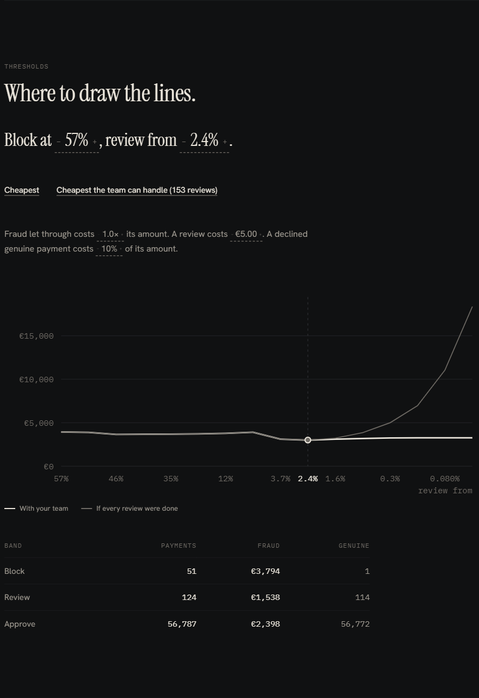
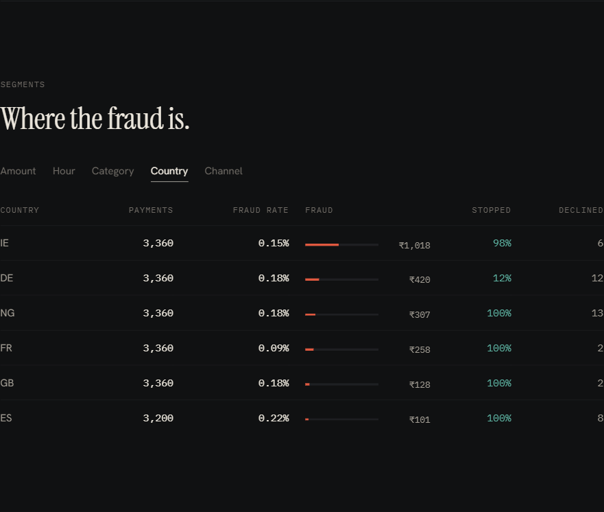
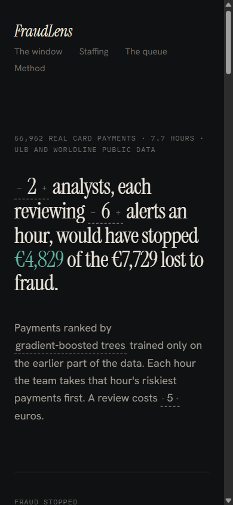

# FraudLens

A fraud-operations workbench that runs in your browser. Drop in a CSV of scored, labelled transactions and get the decisions fraud teams usually work out in spreadsheets: where to set the lines, how many analysts you need, where the fraud is, and what every choice costs.

[Open FraudLens](https://online-payment-fraud-detection-ruby.vercel.app)



Your file never leaves the browser, and the page shows the proof: a count of network requests since you opened it, which stays at zero. Without a file, it runs on 56,962 real card payments from the public ULB / Worldline dataset.

## What it answers

| Question | Module |
| --- | --- |
| Where should the block and review lines go? | **Thresholds.** The cheapest pair of lines given what fraud, a review and a declined customer cost you, with or without a cap on reviews |
| Can the team keep up? | **Staffing.** A queue simulation: analysts, minutes per review, auto-approve timeout, riskiest-first or oldest-first. Shows reviews done, reviews timed out and the fraud inside them, waits, and the cheapest team size |
| Where is the fraud? | **Segments.** By amount, hour, merchant, category, country, channel, device or decision, whichever your file has |
| What did the policy actually do? | **Cases.** Every blocked and reviewed payment, worst first, with its outcome. On the public data, each tree-scored case opens to its TreeSHAP explanation |
| What does it cost in my currency? | **Currency.** 30 currencies at European Central Bank reference rates, with the date shown |

Thresholds and staffing are connected: the review band is the team's workload, so a line that looks cheap on paper shows its real cost once reviews start timing out. No commercial fraud tool found during research links the two.




## Your data

| Field | Required | Recognised headers |
| --- | --- | --- |
| Time | yes | time, timestamp, date, created_at, trans_date_trans_time |
| Amount | yes | amount, amt, value, total (both 1,234.56 and 1.234,56 read) |
| Score | yes | score, risk, risk_score, probability, prediction |
| Fraud outcome | yes | fraud, is_fraud, label, class, chargeback (1/0, true/false, yes/no) |
| Transaction id, second score, merchant, category, country, channel, device, decision | no | common names for each |

Comma, semicolon, tab or pipe separated. Columns are detected automatically and can be changed; the mapping is remembered in your browser for files with the same header. A column of full card numbers (13 to 19 digits passing the Luhn check) stops the import. Parsing runs in a background worker, so large files don't freeze the page.




The sample file in the two screenshots above uses real payments from the public data with made-up category, country and channel columns added, to show the segment views.

Settings (team, costs, currency) are kept in the page address, so a link reproduces the same view. Data is never put in the link.

## The public data

| | |
| --- | --- |
| Dataset | Credit Card Fraud Detection, ULB Machine Learning Group and Worldline |
| Contents | 284,807 card payments, September 2013, 492 fraud. Fields published as anonymous components V1–V28, plus time and amount |
| Licence | Open Database License (ODbL) 1.0 |
| Shown | The last 20% by time: 56,962 payments, 75 fraud, €7,729. No model saw them while learning |

| Model | PR-AUC (95% interval) |
| --- | --- |
| Gradient-boosted trees | 0.766 (0.686–0.862) |
| Logistic regression | 0.796 (0.688–0.884) |
| Isolation forest, no labels | 0.029 (0.022–0.042) |

Protocol: [docs/benchmark.md](docs/benchmark.md). Reproduce with `npm run benchmark` (downloads the dataset once, checked by SHA-256).



## How it calculates

- Block at or above the block line, review between the lines, approve below.
- Reviews queue as they arrive; each analyst takes one at a time; a review not started before the timeout is approved.
- A reviewed fraud is stopped. Fraud let through costs its amount times the fraud cost multiple. A declined genuine payment costs the decline share of its amount.
- Cheapest lines: the lowest total cost over all pairs of cut points in the ranking (prefix sums, so it stays fast on millions of rows), assuming every review is done; the capacity version caps the review band at what the team can handle.

## Run and test

```bash
npm install
npm run dev -w apps/web
npm run lint && npm run typecheck && npm test
npm run test:e2e
```

Engine tests include a brute-force check that the threshold optimiser finds the true cheapest policy, and a timing test for a 10,000-analyst team on 50,000 reviews.

`apps/api` is a separate real-time scoring service (Fastify): score a payment or a batch, stream decisions, record analyst labels, retrain a challenger. Its model uses behavioural features the public data doesn't have, so it is trained on a simulated payment history (`npm run train`).

## Licence

Code: MIT. Payment data: © ULB Machine Learning Group and Worldline, ODbL 1.0; `apps/web/public/replay.json` is a derived database offered under the same licence. Exchange rates: European Central Bank.
