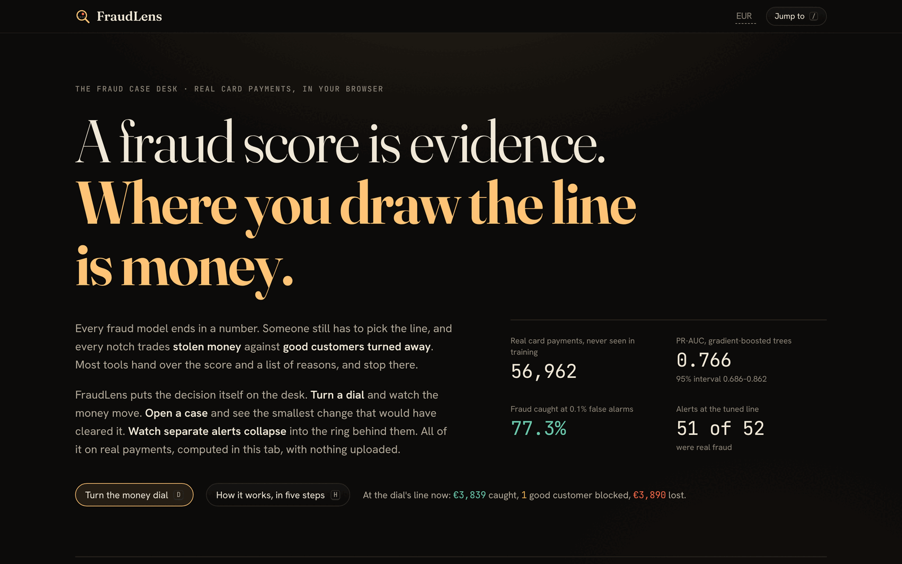
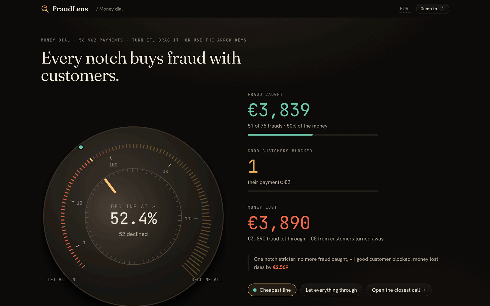
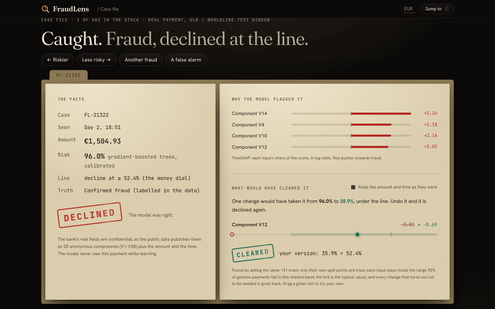
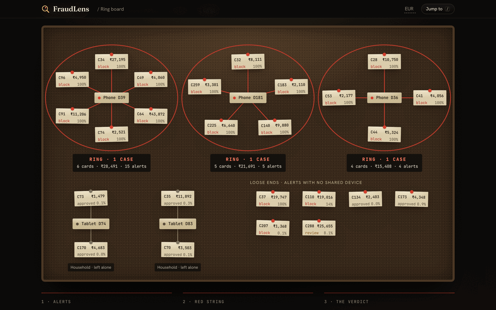
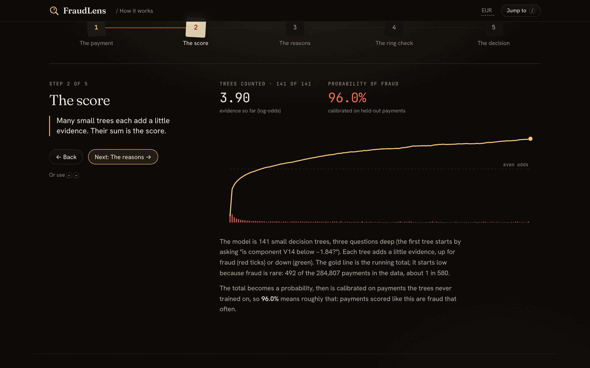

# FraudLens

**A fraud score is evidence. Where you draw the line is money.**

FraudLens is a case desk for payment fraud that runs in your browser. Turn a dial and watch fraud caught, good customers blocked and money lost move together. Open a case file and see the smallest change that would have cleared the payment. Watch separate alerts collapse into the fraud ring behind them.

[Open the case desk](https://fraudlens-casedesk.vercel.app)



## The idea

- **The problem.** Every fraud model ends in a number. Someone still has to pick the line, and each notch trades stolen money against good customers turned away. Most tools hand over the score and a list of reasons and stop there. The decision, and what it costs, is left to a spreadsheet.
- **The idea.** Put the decision itself on the desk: the trade as something you turn by hand, the counterfactual for every flagged payment, and the ring as something you can watch being found.
- **What's different.** Reason lists say why a score is high. FraudLens also says what would have made it low, searched on the same trees that scored the payment and kept inside the range genuine payments fall in. And it prices every line in money, not just in precision and recall.
- **The numbers** (real card payments, never seen in training, from the [benchmark](docs/benchmark.md)):

| | |
| --- | --- |
| Test window | 56,962 card payments, 75 fraud, €7,729 of fraud |
| PR-AUC, gradient-boosted trees | 0.766 (95% interval 0.686–0.862) |
| Fraud caught at a 0.1% false-alarm rate | 77.3% |
| Alerts at the line tuned on validation | 52, of which 51 were fraud |
| Cheapest line on the money dial (fraud 1× its amount, a blocked customer 10%) | €3,839 caught, 1 good customer blocked, €3,890 lost |

## Try it

| Feature | What it does | Try it |
| --- | --- | --- |
| **Money dial** | One line: decline everything at or above it. Drag, scroll or use the arrow keys; fraud caught, good customers blocked and money lost follow the hand. The ring of bars round the rim is the money lost at every position, so the cheapest line is its lowest point (the green dot). The line travels in the link. | [/dial](https://fraudlens-casedesk.vercel.app/dial) or press **D** |
| **Case file, with a counterfactual** | One real payment: the facts, the stamp at the dial's line, the TreeSHAP reasons, and *what would have cleared it*: the fewest, smallest input changes that bring the score under the line. Every change shown is needed (undo any one and it is declined again). Drag a change yourself and watch the stamp. | [/case/fraud](https://fraudlens-casedesk.vercel.app/case/fraud), [/case/false-alarm](https://fraudlens-casedesk.vercel.app/case/false-alarm) or press **C** |
| **Shareable case file** | Copy a link that reopens the exact case at the exact line, save the case file as a 1200×630 image, or use the phone's share sheet. | the Share bar under any case file |
| **Ring board** | 33 alerts, one ticket each. Unmask: red string runs from each card to the phone it was used on, the cards gather, and three rings are stamped: 24 tickets become 3 cases. Two households sharing a tablet are left alone. | [/rings/unmask](https://fraudlens-casedesk.vercel.app/rings/unmask) or press **R** |
| **How it works** | One real payment followed through five steps (below). | [/how](https://fraudlens-casedesk.vercel.app/how) or press **H** |
| **Ledger** | The operations view: block and review lines, a review-queue simulation for team size, where the fraud is by segment, every case the policy touched, 30 currencies, and your own CSV of scored payments, analysed in the browser with a live count of network requests (zero). | [/ledger](https://fraudlens-casedesk.vercel.app/ledger) or press **L** |
| **Jump to** | A command palette for every scene and action. | press **/** or **Ctrl K** |







## How it works

The walkthrough follows one real payment, a €1,504.93 fraud from the test window:

1. **The payment.** It reaches the model as 30 numbers: 28 anonymous components (the bank's fields are confidential), the amount and the time. Each is drawn against the range where 90% of genuine payments sit; 15 of its 30 fall outside.
2. **The score.** 141 small trees, three questions deep, each add a little evidence. The running total becomes a probability, calibrated on payments the trees never trained on: 96.0%.
3. **The reasons.** TreeSHAP shares the score out exactly between the inputs; four components did most of the work.
4. **The ring check.** Some fraud only shows as a group: cards sharing a phone. The public data has no device ids, so this payment can't be checked, and the walkthrough says so and shows the check on the simulated ring board instead.
5. **The decision.** At the dial's line it is declined. The counterfactual: one component changed, and the score would have fallen to 35.9%. The model gives evidence; the money decides the line.




## The data

| | |
| --- | --- |
| Real payments | Credit Card Fraud Detection, ULB Machine Learning Group and Worldline: 284,807 card payments, September 2013, 492 fraud. **Licence: Open Database License (ODbL) 1.0.** The app uses the last 20% by time, which no model saw while learning. `replay.json` and `case-model.json` in `apps/web/public` are derived databases under the same licence |
| Ring board | Six hours of payments from FraudLens's own simulator (the public data has no card or device ids), each scored by the model trained on the simulated history. Labelled as simulated wherever it appears |
| Exchange rates | European Central Bank reference rates |

Reproduce: `npm run benchmark` (downloads the dataset once and checks its SHA-256, then writes every number above), `npm run train` and `npm run rings` for the simulated side. Protocol and full results: [docs/benchmark.md](docs/benchmark.md).

## Quality

Lighthouse on the production build (Lighthouse 12.8, served locally with `vite preview`):

| Scene | Mobile: performance · accessibility · best practices · SEO | Desktop |
| --- | --- | --- |
| Desk (/) | 97 · 100 · 100 · 100 | 100 · 100 · 100 · 100 |
| Money dial | 93 · 100 · 100 · 100 | 99 · 100 · 100 · 100 |
| Case file | 79 · 100 · 100 · 100 | 98 · 100 · 100 · 100 |
| Ring board | 90 · 100 · 100 · 100 | 100 · 100 · 100 · 100 |
| How it works | 94 · 100 · 100 · 100 | 99 · 100 · 100 · 100 |
| Ledger | 63 · 100 · 100 · 100 | 89 · 100 · 100 · 100 |

Measured on 2026-11-20 with Lighthouse's default simulated throttling. The case file and the ledger are below 95 on mobile: both draw from all 56,962 payments (1.8 MB of JSON, 315 kB gzipped) before their headline can render, and the ledger then runs its queue simulations.

## Run and test

```bash
npm install
npm run dev -w apps/web      # the case desk
npm run lint && npm run typecheck && npm test
npm run test:e2e             # builds, then drives every scene in Chromium
```

Unit tests include: the exported trees reproduce every published score; every counterfactual lands under the line, stays in the genuine range and needs every change it lists; the dial's cheapest line matches brute force; every ring the detector unmasks is real fraud in the simulator's ground truth; the ledger's optimiser and review-queue simulation. End-to-end tests turn and drag the dial, open, walk and share case files, unmask the rings, walk How it works, use the palette and shortcuts, import CSVs, and check every scene on a phone.

`apps/api` is a separate real-time scoring service (Fastify) on the same core: score a payment or a batch, stream decisions, record analyst labels, retrain a challenger. Its model uses behavioural features the public data lacks, so it is trained on the simulated history.

## Licence

Code: MIT. Card payment data: © ULB Machine Learning Group and Worldline, ODbL 1.0. Exchange rates: European Central Bank.
