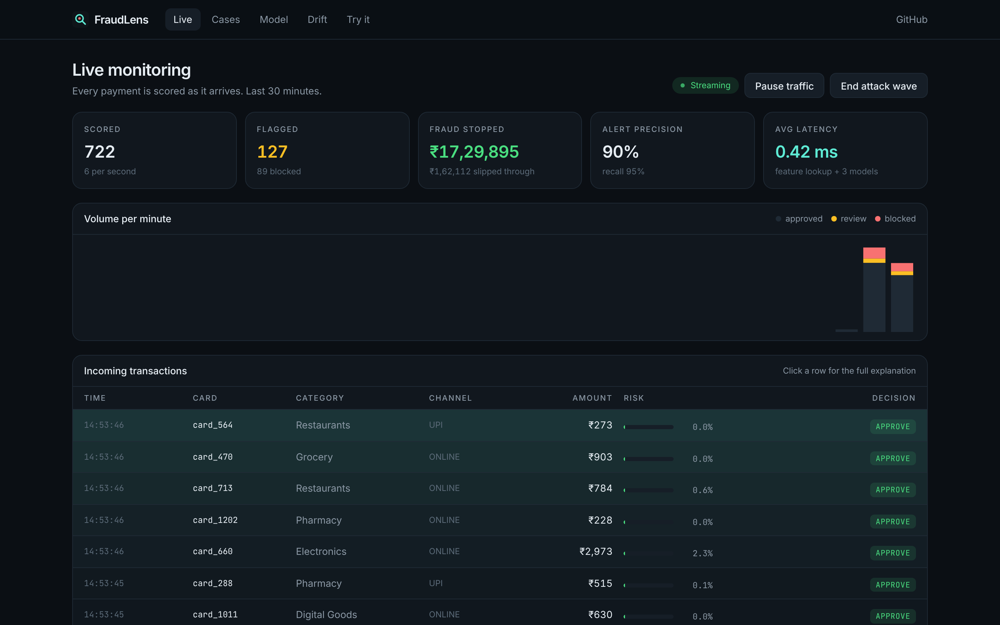
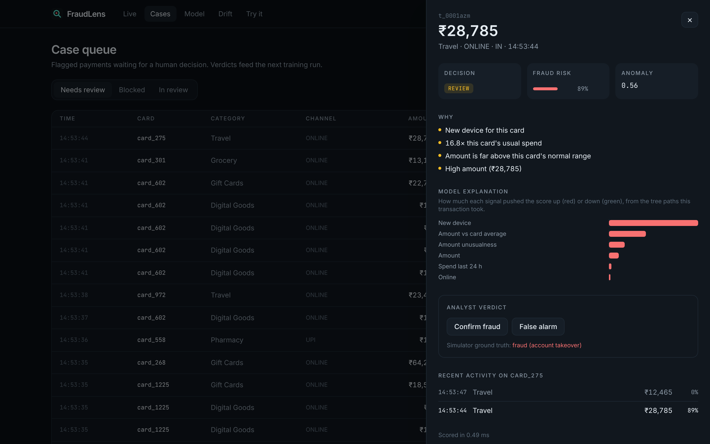
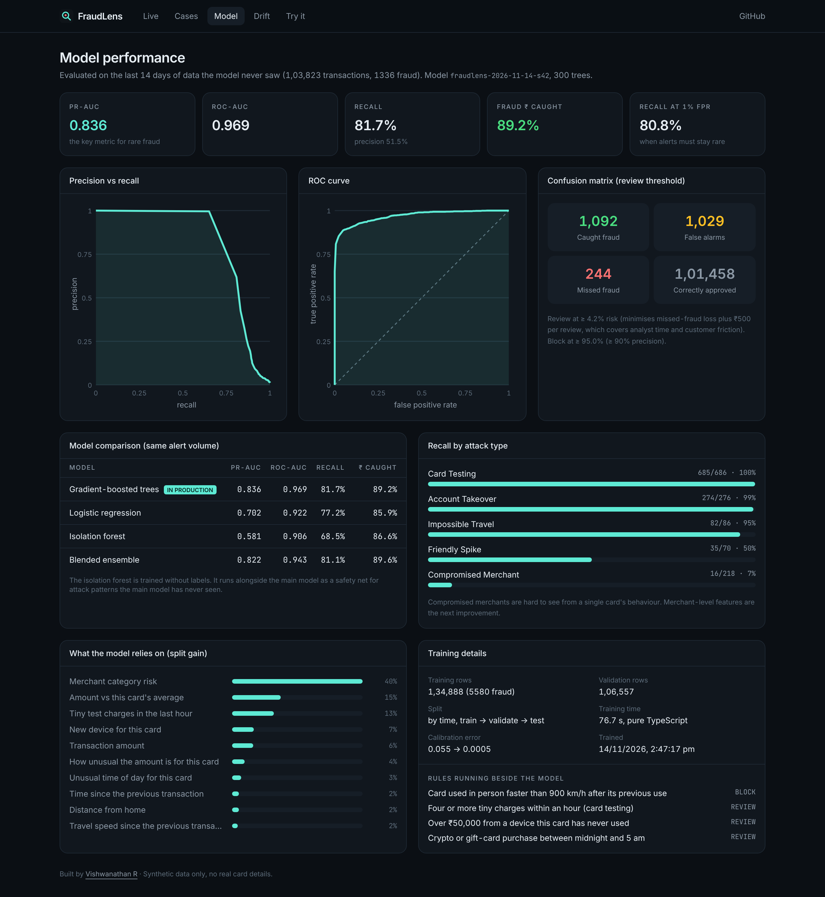
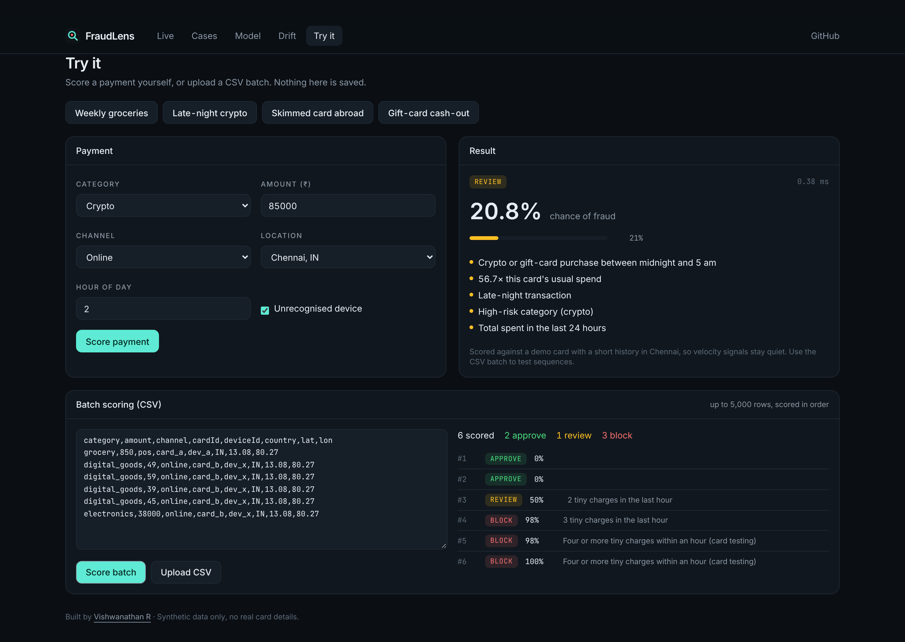
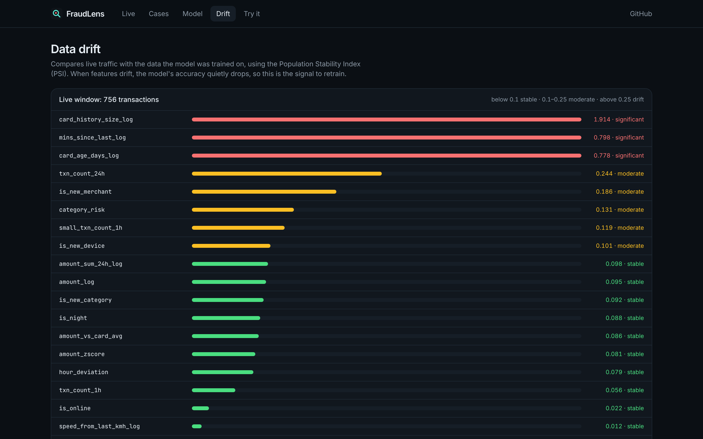
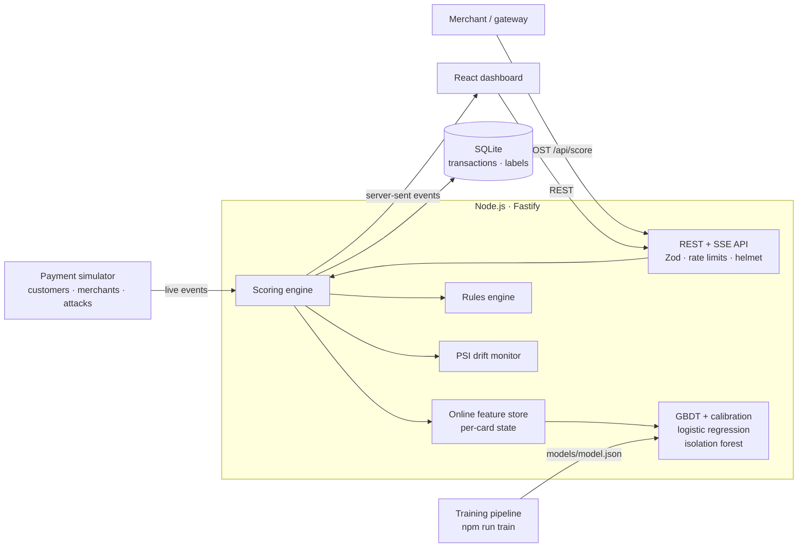

# FraudLens · Real-time payment fraud detection

> Built by [Vishwanathan R](https://vishwanathan.dev) · [Portfolio](https://vishwanathan.dev) · [Resume](https://vishwanathan.dev/resume.pdf)

FraudLens scores every card payment in **under a millisecond**, explains **why** it flagged it, and gives analysts a live dashboard to review cases. It is built **end to end in TypeScript**:

- the machine-learning models, written from scratch
- a streaming Node.js API
- a React dashboard



> Version 2 is a full rebuild. The original Python and Streamlit version is kept on the [`v1-python`](https://github.com/Vishwanathanirv/online-payment-fraud-detection/tree/v1-python) branch.

## Results

Each model is tested on the **last 14 days of a 90-day simulation**, which it never saw during training. That is 103,823 transactions, 1,336 of them fraud. The split is by time, so the model is always predicting the future, never peeking at it.

| Model | PR-AUC | ROC-AUC | Recall | Precision | Fraud ₹ caught |
| --- | --- | --- | --- | --- | --- |
| **Gradient-boosted trees (production)** | **0.836** | **0.969** | **81.7%** | **51.5%** | **89.2%** |
| Logistic regression (baseline) | 0.702 | 0.922 | 77.2% | 48.7% | 85.9% |
| Isolation forest (no labels) | 0.581 | 0.906 | 68.5% | 43.1% | 86.6% |

- At a 1% false-positive rate, the production model still catches **80.8%** of fraud.
- Calibration cuts the expected calibration error from **0.055 to 0.0005**. So a score of 20% really means about a 1-in-5 chance of fraud.
- The thresholds are set by **business cost**, not by guesswork. An alert is sent for review at the risk level that minimises missed-fraud losses plus ₹500 per review. A payment is blocked only when precision is above 90%.

**Recall by attack type:**

| Attack type | Recall |
| --- | --- |
| Card testing | 100% |
| Account takeover | 99% |
| Impossible travel | 95% |
| Friendly spike | 50% |
| Compromised merchant | 7% |

Compromised merchants are hard to see from one card's behaviour alone. Adding merchant-level features is the next step (see the roadmap below).

All data is synthetic, so these numbers describe the simulator, not a real bank. The simulator includes realistic look-alikes (holidays abroad, big one-off purchases, new phones) so the problem is not trivially separable.

## Features

- **Models written from scratch in TypeScript, with no ML libraries:**
  - histogram-based gradient-boosted trees, with second-order gain, L2 regularisation, row and column sampling, class weighting and early stopping
  - logistic regression trained with Adam
  - isolation forest
  - Platt calibration
- **Explainable decisions.** Every score comes with per-feature contributions from the tree paths (Saabas attribution) and plain-English reasons, such as "6.2× this card's usual spend" or "4 tiny charges in the last hour".
- **Online feature store.** 20 behavioural features per card: spending baselines, velocity, new device, new merchant or new category, distance from home, implied travel speed and time-of-day habits. The same code builds training data and scores live traffic, so there is **no training/serving skew**.
- **Rules plus model.** Auditable business rules (impossible travel, card testing, high value on a new device, late-night crypto) run alongside the model. The isolation forest acts as a safety net for unseen patterns.
- **Live dashboard:**
  - real-time stream over server-sent events, with KPIs and per-minute volume
  - a case queue with analyst verdicts (confirm fraud or false alarm)
  - model report: PR and ROC curves, confusion matrix, feature importance, model comparison
  - data-drift monitoring (Population Stability Index)
  - a playground for single payments and CSV batches
- **Production touches:**
  - Zod validation, rate limiting, security headers, and optional admin token for controls
  - SQLite through Node's built-in `node:sqlite`, so there are no native add-ons
  - multi-stage Docker image with a health check
  - CI that tests, builds and smoke-tests the container

| Case review with explanation | Model report |
| --- | --- |
|  |  |

| Try it: single and batch scoring | Drift monitoring |
| --- | --- |
|  |  |

## Architecture



```
packages/core      ML library: simulator, features, GBDT, logistic regression, isolation forest,
                   metrics, calibration, drift, scorer, training pipeline (pure TypeScript)
apps/api           Fastify server: scoring, batch scoring, stream, cases, stats, drift, rules
apps/web           React + Vite + Tailwind dashboard
scripts/train.ts   Simulates 90 days, trains, evaluates and writes models/model.json
```

## Run it

You need Node 22.13 or newer.

```bash
git clone https://github.com/Vishwanathanirv/online-payment-fraud-detection.git
cd online-payment-fraud-detection
npm install
npm run build && npm start      # http://localhost:8080
```

For development with hot reload, run `npm run dev`. It starts the API on port 8080 and the dashboard on 5173.

A trained model is included. To retrain it (about 75 seconds):

```bash
npm run train                   # SEED=7 DAYS=120 CUSTOMERS=6000 npm run train
```

Or run it with Docker:

```bash
docker build -t fraudlens . && docker run -p 8080:8080 fraudlens
```

### API

| Method | Path | Description |
| --- | --- | --- |
| `POST` | `/api/score` | Score one payment. Returns probability, decision, reasons and contributions. Add `?record=true` to store it. |
| `POST` | `/api/score/batch` | Score up to 5,000 payments in time order. |
| `GET` | `/api/stream` | Server-sent events, one per scored transaction. |
| `GET` | `/api/transactions` | Filter by `decision`, `unlabeled`, `cardId`. |
| `POST` | `/api/transactions/:id/label` | Analyst verdict: `fraud` or `legit`. |
| `GET` | `/api/stats`, `/api/drift`, `/api/model` | KPIs, drift (PSI) and the full training report. |
| `PUT` | `/api/simulator`, `PATCH /api/rules/:id` | Demo controls. Protected when `ADMIN_TOKEN` is set. |

```bash
curl -s localhost:8080/api/score -H 'content-type: application/json' \
  -d '{"category":"crypto","amount":85000,"channel":"online","deviceId":"new-phone"}'
```

## Tests

```bash
npm run lint && npm run typecheck
npm test        # 24 tests: metrics, models, features, simulator, training pipeline, API
```

The tests check behaviour, not just shapes. For example:
- the trees learn a non-linear interaction
- explanation contributions add up exactly to the model's output
- calibration reduces error
- PSI detects a shifted distribution
- a card-testing burst is blocked through the API

## Deploy

The repo includes a `Dockerfile` and a `render.yaml`. On [Render](https://render.com): click **New → Blueprint** and pick this repo. Any host that runs a Docker container works the same way. Mount a volume at `/data` to keep the database between restarts.

## Roadmap

- Merchant-level features, such as the recent alert rate per merchant, to catch compromised merchants
- Retraining from analyst labels, with the champion and challenger compared on the same test window
- Graph features that link cards sharing devices, a common sign of fraud rings

## Tech stack

TypeScript · Node.js 22 · Fastify · node:sqlite · Zod · React 19 · React Router · Vite · Tailwind CSS 4 · Vitest · esbuild · Docker · GitHub Actions

## License

MIT © Vishwanathan R
