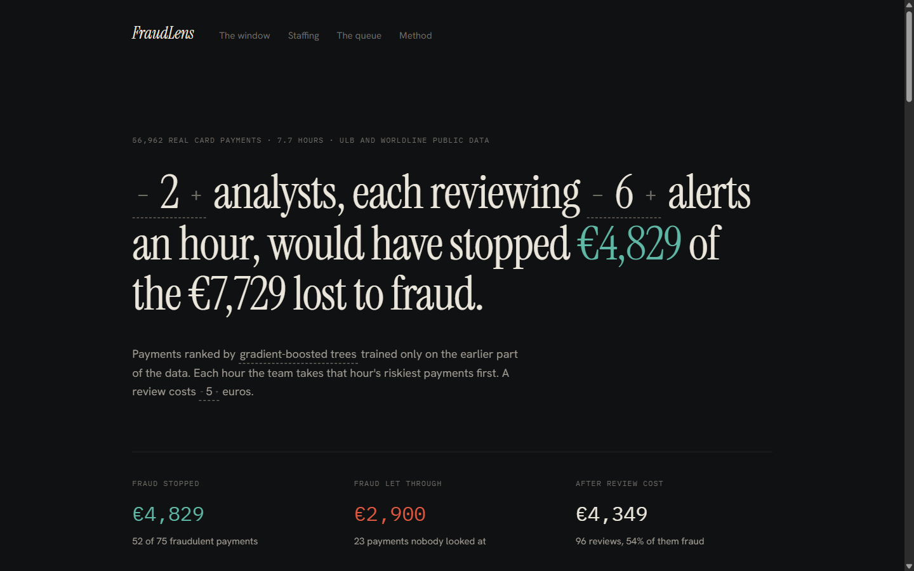
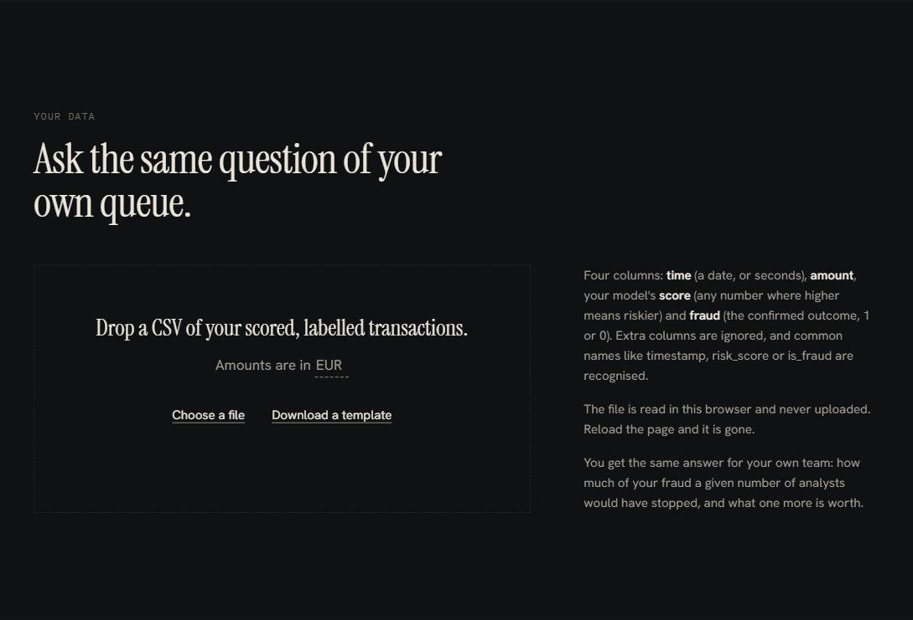
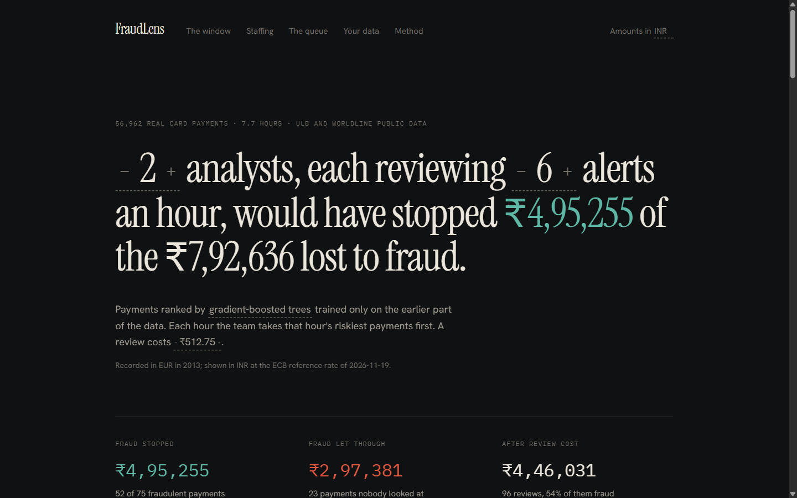
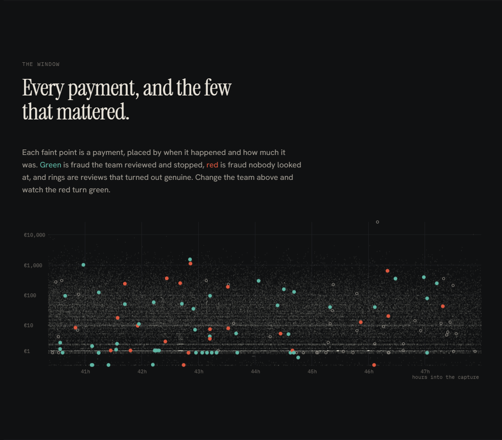
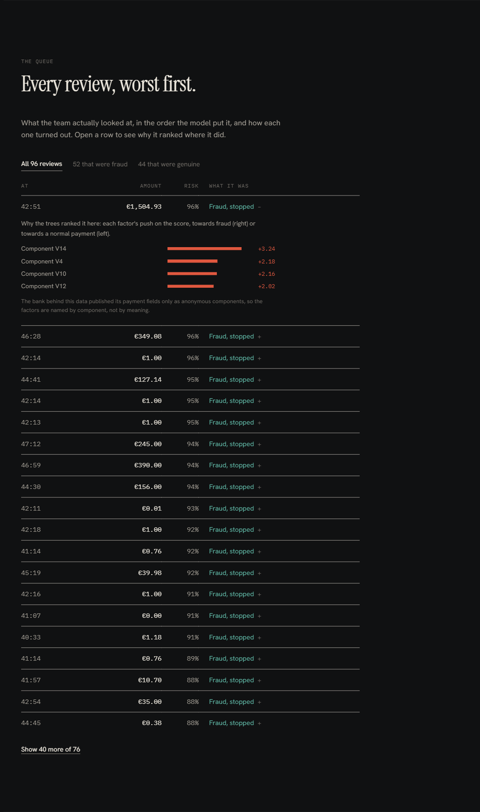

# FraudLens

**How many analysts does a card-fraud review queue need, and what is the next one worth?**

[Open the analysis →](https://online-payment-fraud-detection-ruby.vercel.app)



Every fraud team runs into the same limit. A model can rank payments by risk, but people review the alerts, and there are only so many of them. Too few and fraud walks through; too many and each extra review costs more than the fraud it finds. FraudLens puts a number on that trade-off using **56,962 real card payments** from the public ULB and Worldline dataset, scored by models that never saw them.

Change the team size, how many alerts one person gets through in an hour, the cost of a review, or the model doing the ranking. Every figure on the page is recomputed from the real payments as you go.

## Use it on your own queue

FraudLens answers the same question for your team. Export your scored transactions with their confirmed outcomes, drop the CSV on the page, and every figure, chart and review in the queue is recomputed for your data.

| Column | What it holds | Also recognised as |
| --- | --- | --- |
| `time` | When the transaction happened: a date, or seconds | timestamp, date, created_at |
| `amount` | Its value, in the currency you pick | value, amt |
| `score` | Your model's score; higher means riskier. Probabilities show as a %, anything else as a rank | risk, risk_score, probability, prediction |
| `fraud` | The confirmed outcome: 1/0, true/false, yes/no | is_fraud, label, class, chargeback |

The file is read in the browser and never uploaded. A template is one click away on the page, and a file that can't be used is refused with the exact reason (a missing column, an unreadable row, no fraud to catch).



## In your currency

The public data is recorded in euros. **Amounts in** at the top of the page converts every figure, axis and control to any of 30 currencies at the European Central Bank's euro reference rates, fetched at build time; the page names the date of the rate it used. Rupees are grouped the Indian way (₹4,95,255). Your own data keeps the currency you give it and converts the same way.



## What it shows

**The answer, first.** The headline is the result: fraud stopped out of fraud lost, for the team you describe. Beneath it, fraud let through and the net value after review costs.

**The window.** All 56,962 payments, drawn by time and amount. Fraud the team reviewed is green; fraud nobody looked at is red; reviews that turned out genuine are rings. Hover any marked payment for its details.



**Staffing.** Net value for teams of 0 to 12 people, for each of the three models. It names the most valuable team size and says exactly what one more person would add, or cost.


**The queue.** Every review the team would have made, riskiest first, with how each turned out. Open one ranked by the trees to see its exact TreeSHAP explanation: which factors pushed its score up or down, and by how much.



**Method.** Where the data comes from, how it was split, how well each model ranks fraud with 95% intervals, and the assumptions behind the staffing model.


## The data, and why the numbers can be trusted

| | |
| --- | --- |
| Dataset | Credit Card Fraud Detection, ULB Machine Learning Group and Worldline |
| Contents | 284,807 card payments by European cardholders over two days in September 2013, 492 fraud. Fields are published as anonymous PCA components V1–V28, plus time and amount |
| Licence | Open Database License (ODbL) 1.0 |
| Integrity | The download is checked against SHA-256 `76274b69…51a89` and refused otherwise |
| Split | By time, never at random: first 60% to train, next 20% to tune, last 20% (shown on the page) untouched until the end |

Everything that is tuned (the tree hyperparameters, early stopping and calibration) is tuned on the middle window. The page only ever shows the last one. Scores are calibrated, so a risk of 20% means roughly one such payment in five is fraud.

| Model | PR-AUC on the test window (95% interval) |
| --- | --- |
| Gradient-boosted trees | 0.766 (0.686–0.862) |
| Logistic regression | 0.796 (0.688–0.884) |
| Isolation forest, trained without labels | 0.029 (0.022–0.042) |

With 75 frauds in the test window the intervals are wide. The trees and logistic regression are statistically tied. The isolation forest ranks poorly at the top of the list, which is why it stops almost nothing at small team sizes. The full protocol is in [docs/benchmark.md](docs/benchmark.md).

**Assumptions in the staffing model**, stated on the page too: each hour's queue holds that hour's riskiest payments; a reviewed fraud is stopped; every review costs the same. Real analysts sometimes miss fraud they look at and spend longer on harder cases, so treat the result as an upper bound on what a team of that size can do.

## Reproduce it

You need Node 22.13 or newer.

```bash
npm install
npm run benchmark   # downloads the dataset once (~150 MB, checked by SHA-256), trains, evaluates, ~5 minutes
npm run dev -w apps/web
```

`npm run build:demo -w apps/web` fetches the ECB rates (keeping the committed `rates.json` if the ECB can't be reached) and builds the page. `npm run benchmark` rewrites `docs/benchmark.json` (the summary) and `apps/web/public/replay.json` (every test-window payment with its real time, amount and label, each model's calibrated score, and TreeSHAP factors for every payment the trees score at 0.5% or more, and for every fraud: 402 in all). Run it twice and you get the same numbers: the split, the search and the seeds are fixed.

## Inside

```
packages/core     Machine learning written from scratch in TypeScript: gradient-boosted trees with exact
                  TreeSHAP, logistic regression, isolation forest, Platt calibration, PR/ROC metrics,
                  bootstrap intervals, cost-optimal thresholds, drift (PSI)
scripts           benchmark.ts: the real-data protocol above. train.ts: the scoring service's model
apps/web          The analysis page: React 19, Vite, Tailwind CSS 4, a canvas chart for 56,962 points
apps/api          A real-time scoring service (Fastify) for integrating the engine with a payment flow
```

No machine-learning library is used: the trees, their explanations and the metrics are implemented and tested here.

### The scoring service

`apps/api` exposes the engine for live use: score a payment, score a batch, stream decisions, record analyst labels and retrain a challenger on them. Its model uses behavioural features the public dataset cannot provide (card velocity, distance from home, new devices, devices shared across cards), so it is trained on a simulated payment history (`npm run train`). The analysis page does not use it.

```bash
npm run build && npm start     # http://localhost:8080
docker build -t fraudlens . && docker run -p 8080:8080 fraudlens
curl -s localhost:8080/api/score -H 'content-type: application/json' \
  -d '{"category":"electronics","amount":42000,"channel":"pos","deviceId":"new-phone"}'
```

| Method | Path | What it does |
| --- | --- | --- |
| `POST` | `/api/score` | Score one payment: probability, decision, reasons, TreeSHAP contributions |
| `POST` | `/api/score/batch` | Score up to 5,000 payments in time order |
| `GET` | `/api/stream` | Server-sent events, one per scored payment |
| `POST` | `/api/transactions/:id/label` | Record an analyst's verdict |
| `POST` | `/api/feedback/challenge`, `/api/feedback/promote` | Train a challenger on confirmed outcomes; promote it only if it does better |
| `GET` | `/api/rings` | Groups of cards tied together by shared devices |

## Tests

```bash
npm run lint && npm run typecheck
npm test           # the models, explanations (contributions sum exactly to the output), calibration, metrics, drift, the API
npm run test:e2e   # the page on real data: staffing changes the outcome, the queue explains its ranking, phones
```

## Licence

Code: MIT. Payment data: © ULB Machine Learning Group and Worldline, ODbL 1.0. The full dataset is downloaded by the benchmark, not stored here. `apps/web/public/replay.json` holds the test window's time, amount and label for each payment with the models' scores; it is a derived database and is offered under the same ODbL 1.0.
