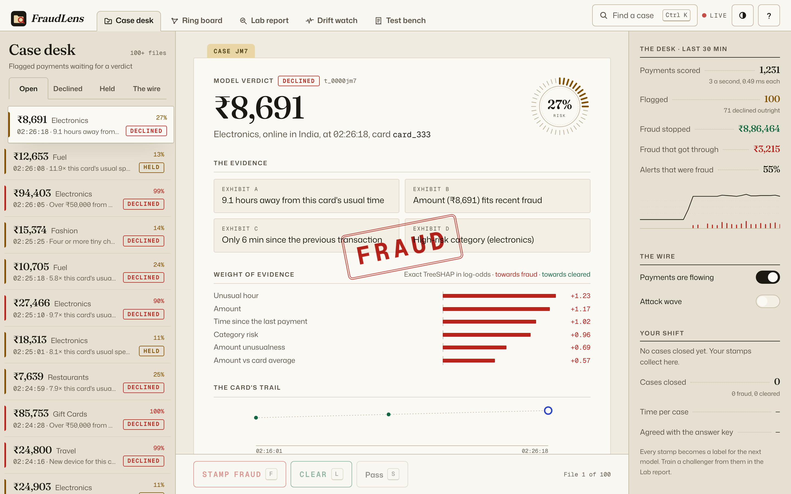
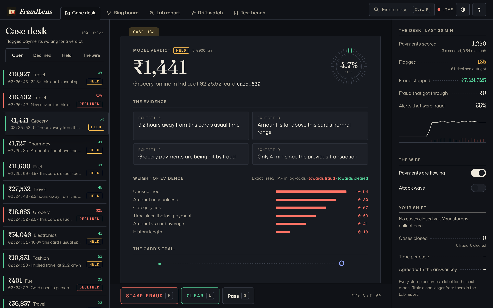
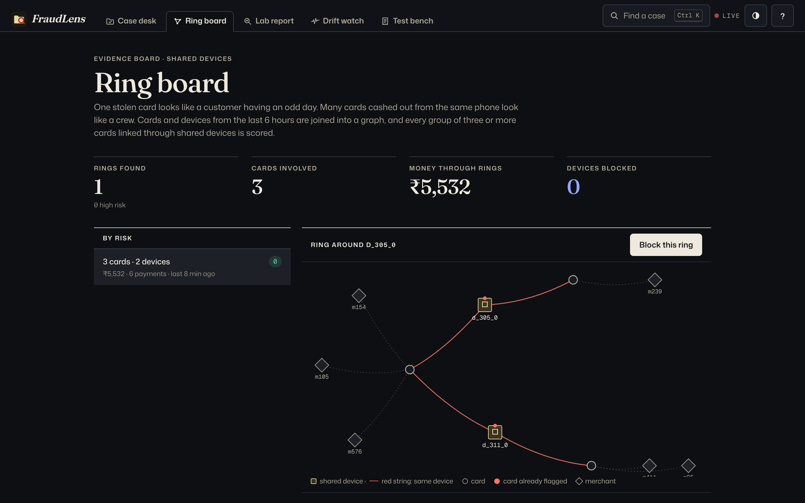
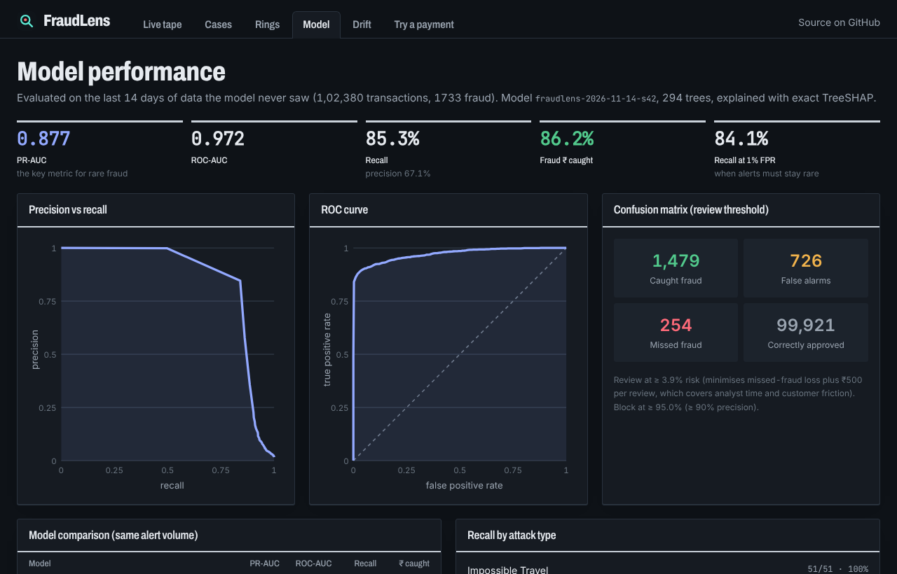
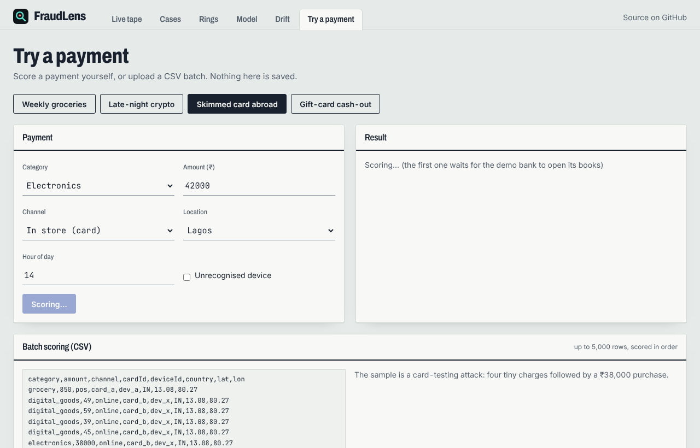
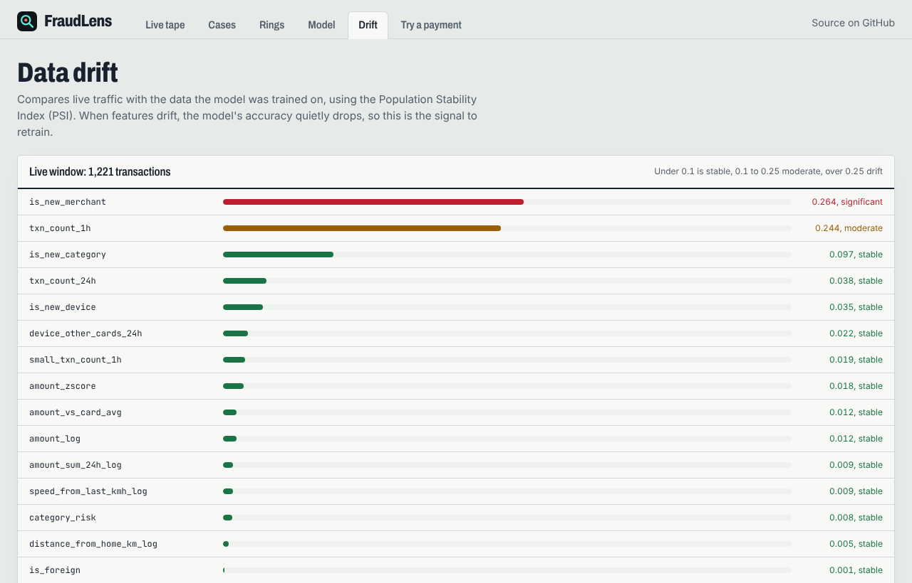
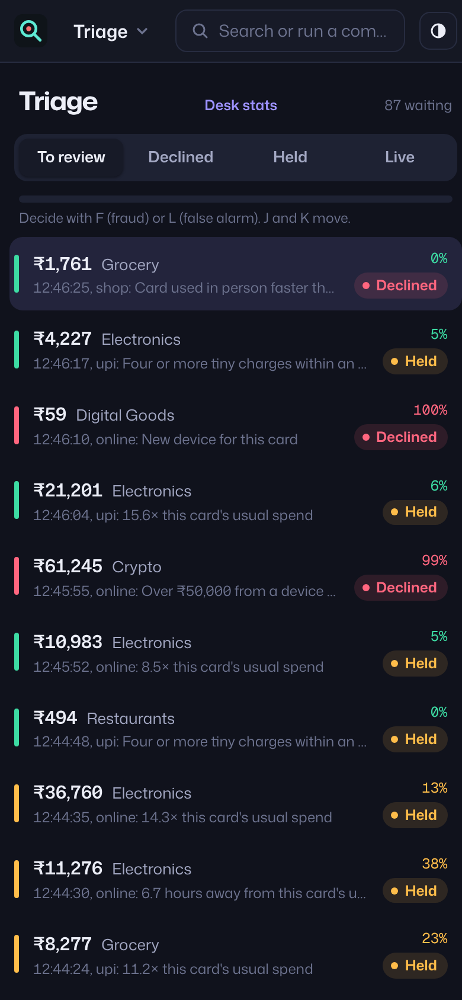
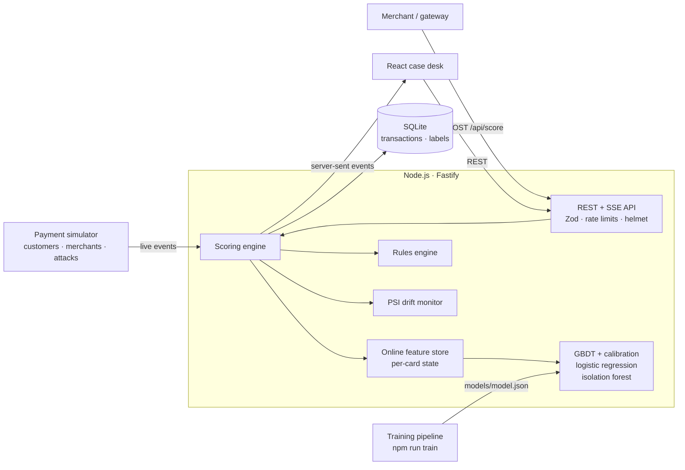

# FraudLens · The case desk for card fraud



**[Live demo → fraudlens-casedesk.vercel.app](https://fraudlens-casedesk.vercel.app)**: opens straight onto live traffic, nothing to install or sign up for.

FraudLens scores every card payment in **under a millisecond**, explains **why** it flagged it, and gives analysts a case desk to work the flags. It is built **end to end in TypeScript**:

- the machine-learning models, written from scratch
- a streaming Node.js API
- a React case desk

> Version 2 is a full rebuild. The original Python and Streamlit version is kept on the [`v1-python`](https://github.com/Vishwanathanirv/online-payment-fraud-detection/tree/v1-python) branch.

## Results

Each model is tested on the **last 14 days of a 90-day simulation**, which it never saw during training. That is 102,380 transactions, 1,733 of them fraud. The split is by time, so the model is always predicting the future, never peeking at it.

| Model | PR-AUC | ROC-AUC | Recall | Precision | Fraud ₹ caught |
| --- | --- | --- | --- | --- | --- |
| **Gradient-boosted trees (production)** | **0.877** | **0.972** | **85.3%** | **67.1%** | **86.2%** |
| Logistic regression (baseline) | 0.805 | 0.942 | 81.0% | 63.6% | 84.4% |
| Isolation forest (no labels) | 0.493 | 0.922 | 58.9% | 46.3% | 78.4% |

- At a 1% false-positive rate, the production model still catches **86.0%** of fraud.
- Calibration cuts the expected calibration error from **0.062 to 0.0004**. So a score of 20% really means about a 1-in-5 chance of fraud.
- The thresholds are set by **business cost**, not by guesswork. An alert is sent for review at the risk level that minimises missed-fraud losses plus ₹500 per review. A payment is blocked only when precision is above 90%.

**Recall by attack type:**

| Attack type | Recall |
| --- | --- |
| Card testing | 100% |
| Impossible travel | 100% |
| Fraud ring (one device, many stolen cards) | 99% |
| Account takeover | 98% |
| Friendly spike | 47% |
| Compromised merchant | 7% |

Compromised merchants are hard to see from one card's behaviour alone. Adding merchant-level features is the next step (see the roadmap below).

These numbers come from the simulator, not a real bank. The simulator includes realistic look-alikes (holidays abroad, big one-off purchases, new phones) so the problem is not trivially separable.

### On real card data

The same from-scratch models were also run on the public **ULB / Worldline credit-card fraud dataset** (284,807 real European card payments, 492 fraud, ODbL 1.0). The split is by time (60/20/20); hyperparameters, calibration and the alert threshold are chosen on validation only; the last 20% is used once, to report. Each alert costs €5 of review time and each missed fraud costs its amount. Reproduce with `npm run benchmark`; the full method is in [docs/benchmark.md](docs/benchmark.md).

| Model (test: 56,962 payments, 75 fraud) | PR-AUC (95% CI) | ROC-AUC | Recall @ 0.1% FPR | Recall @ 1% FPR | Alerts | Saved vs no model |
| --- | --- | --- | --- | --- | --- | --- |
| Gradient-boosted trees | 0.766 (0.686–0.862) | 0.985 | 77.3% | 86.7% | 52 | €3,579 of €7,729 |
| Logistic regression | 0.796 (0.688–0.884) | 0.976 | 80.0% | 85.3% | 250 | €4,097 of €7,729 |
| Isolation forest (no labels) | 0.029 (0.022–0.042) | 0.944 | 0.0% | 36.0% | 606 | €520 of €7,729 |

On this dataset the trees and logistic regression are statistically tied. The anonymised PCA features are close to linear, and there are no card or device IDs, so the behavioural features that give the trees their edge above cannot be built.

## Features

- **Models written from scratch in TypeScript, with no ML libraries:**
  - histogram-based gradient-boosted trees, with second-order gain, L2 regularisation, row and column sampling, class weighting and early stopping
  - logistic regression trained with Adam
  - isolation forest
  - Platt calibration
- **Exact explanations.** Every score is broken down with exact **TreeSHAP** (Lundberg et al., 2018), implemented from scratch and tested against brute-force Shapley values. Contributions add up exactly to the model's raw score (its log-odds before calibration, relative to the average payment), and come with plain-English reasons such as "6.2× this card's usual spend" or "This device paid with 5 other cards in the last 24 hours". The drawer shows the strongest signals in both directions: what pushed risk up and what pulled it down. Risky payments are explained the moment they are scored; safe ones are explained when someone opens them, which is most of the work saved (TreeSHAP is about 70% of scoring time) and lets the demo open in about a second.
- **Fraud-ring detection.** Cards and devices from the last six hours form a graph. Union–find joins cards linked through shared devices, and each group is scored by how densely cards are packed onto devices, how concentrated the money is on one merchant, and how much the model already flagged. Households (two cards on a family tablet) score zero. An analyst can block a ring, and every later payment from its devices is declined whatever card is used.
- **Feedback loop with champion/challenger.** Analyst verdicts and chargebacks become training data. A challenger continues boosting from the live model (warm start: the old trees stay, new trees fix recent mistakes), is tested on later traffic it never saw at the **same alert workload** as the live model, and is promoted only if it ranks fraud better without catching less. Model versions are tracked.
- **Online feature store.** 21 behavioural features per card and device: spending baselines, velocity, new device, new merchant or new category, distance from home, implied travel speed and time-of-day habits. The same code builds training data and scores live traffic, so there is **no training/serving skew**.
- **Rules plus model.** Auditable business rules (impossible travel, card testing, high value on a new device, late-night crypto) run alongside the model. The isolation forest acts as a safety net for unseen patterns.
- **Honest drift monitoring.** Population Stability Index per feature. Time-of-day features always shift in a window of a few minutes, and card-history features shift when the live system has seen less history than training, so those are reported as expected shifts with the reason rather than as false alarms; real drift is listed first.
- **A realistic test customer.** The "Try a payment" page scores against six weeks of ordinary Chennai spending on one phone, so the examples behave as they would for a real card: groceries are approved, a skimmed card in Lagos is held (38× usual spend, implied travel at hundreds of km/h), late-night crypto and gift-card cash-outs are declined.
- **A case desk, built for speed.** Every flagged payment is a case file in a drawer. The model's reasons are laid out as numbered exhibits, the TreeSHAP weights as a ledger, and the card's recent trail as a timeline. The analyst closes the case with a rubber stamp: **F** for fraud, **L** to clear it as a false alarm. The next file slides in through the View Transitions API. **J/K** move between files, and a command menu (**Ctrl K**) finds any payment or action. The desk ledger shows live numbers, a seismograph of traffic and your shift's stamps, scored against the simulator's answer key. It has paper-and-ink light and dark themes, a thumb bar on phones, full keyboard and screen-reader support, and it respects reduced motion.
- **Live app:**
  - real-time stream over server-sent events, with live desk numbers and per-minute volume
  - keyboard-first case desk with analyst verdicts (fraud or cleared) that feed the next training run
  - a ring board: a live evidence board of cards, devices and merchants, with red string between cards that share a device
  - the feedback loop: train a challenger, compare it with the live model, promote it
  - model report: PR and ROC curves, confusion matrix, feature importance, model comparison
  - data-drift monitoring (Population Stability Index)
  - a playground for single payments and CSV batches
- **Production touches:**
  - Zod validation, rate limiting, security headers, and optional admin token for controls
  - SQLite through Node's built-in `node:sqlite`, so there are no native add-ons
  - multi-stage Docker image with a health check
  - CI that tests, builds and smoke-tests the container

| The desk at night | Ring board |
| --- | --- |
|  |  |

| Lab report | Test bench: single and batch scoring |
| --- | --- |
|  |  |

| Drift watch | On a phone |
| --- | --- |
|  |  |

## Architecture



```
packages/core      ML library: simulator, features, GBDT, logistic regression, isolation forest,
                   metrics, calibration, drift, scorer, training pipeline (pure TypeScript)
apps/api           Fastify server: scoring, batch scoring, stream, cases, stats, drift, rules
apps/web           React + Vite + Tailwind case desk (the in-browser demo runs the engine in a Web Worker)
scripts/train.ts   Simulates 90 days, trains, evaluates and writes models/model.json
```

## Run it

You need Node 22.13 or newer.

```bash
git clone https://github.com/Vishwanathanirv/online-payment-fraud-detection.git
cd online-payment-fraud-detection
npm install
npm run build && npm start      # http://localhost:8080
```

For development with hot reload, run `npm run dev`. It starts the API on port 8080 and the case desk on 5173.

A trained model is included. To retrain it (about 75 seconds):

```bash
npm run train                   # SEED=7 DAYS=120 CUSTOMERS=6000 npm run train
```

Or run it with Docker:

```bash
docker build -t fraudlens . && docker run -p 8080:8080 fraudlens
```

### API

| Method | Path | Description |
| --- | --- | --- |
| `POST` | `/api/score` | Score one payment. Returns probability, decision, reasons and contributions. Add `?record=true` to store it. |
| `POST` | `/api/score/batch` | Score up to 5,000 payments in time order. |
| `GET` | `/api/stream` | Server-sent events, one per scored transaction. |
| `GET` | `/api/transactions` | Filter by `decision`, `unlabeled`, `cardId`. |
| `POST` | `/api/transactions/:id/label` | Analyst verdict: `fraud` or `legit`. |
| `GET` | `/api/stats`, `/api/drift`, `/api/model` | KPIs, drift (PSI) and the full training report. |
| `GET` | `/api/rings` | Fraud rings active in the last six hours, with their graph. |
| `POST` | `/api/rings/:id/block` | Block or unblock a ring's devices: `{"blocked": true}`. |
| `GET` | `/api/feedback` | Outcomes collected, model versions and the last challenger report. |
| `POST` | `/api/feedback/challenge`, `/api/feedback/promote` | Train a challenger on confirmed outcomes; promote it if it won. |
| `PUT` | `/api/simulator`, `PATCH /api/rules/:id` | Demo controls. These, ring blocking and model promotion are protected when `ADMIN_TOKEN` is set. |

```bash
curl -s localhost:8080/api/score -H 'content-type: application/json' \
  -d '{"category":"crypto","amount":85000,"channel":"online","deviceId":"new-phone"}'
```

## Tests

```bash
npm run lint && npm run typecheck
npm test        # 45 tests: metrics, models, features, simulator, drift, explanations, training pipeline, API
npm run test:e2e  # browser tests on the demo build: every view, stamping cases by keyboard and on a phone, command menu, example payments, drift, benchmark
```

The tests check behaviour, not just shapes. For example:
- the trees learn a non-linear interaction
- explanation contributions add up exactly to the model's output
- calibration reduces error
- PSI detects a shifted distribution
- a card-testing burst is blocked through the API

## Deploy

**Static demo on Vercel.** `npm run build:demo` builds the case desk with the API compiled into the browser. The same simulator, feature store, models and rules run client-side in a Web Worker, so the page stays responsive, each visitor gets a private sandbox, and no server is needed. `scripts/deploy-static.sh` uploads just the built files with `vercel.json`'s routing and cache headers. It needs `VERCEL_TOKEN`, `VERCEL_ORG_ID` and `VERCEL_PROJECT_ID`.

Lighthouse on the production build: performance 100 on desktop and 86–93 on mobile (simulated slow 4G and a 4× slower CPU, across three runs); accessibility, best practices and SEO 100 on both.

**Full server.** The repo includes a `Dockerfile` and a `render.yaml`. On [Render](https://render.com): click **New → Blueprint** and pick this repo. Any host that runs a Docker container works the same way. Mount a volume at `/data` to keep the database between restarts.

## Roadmap

- Merchant-level features, such as the recent alert rate per merchant, to catch compromised merchants
- Shadow mode: score live traffic with the challenger for a day before promotion
- Persist promoted models and blocked devices across server restarts

## Tech stack

TypeScript · Node.js 22 · Fastify · node:sqlite · Zod · React 19 · React Router · Vite · Tailwind CSS 4 · Web Workers · View Transitions · Vitest · Playwright · esbuild · Docker · GitHub Actions

## License

MIT
